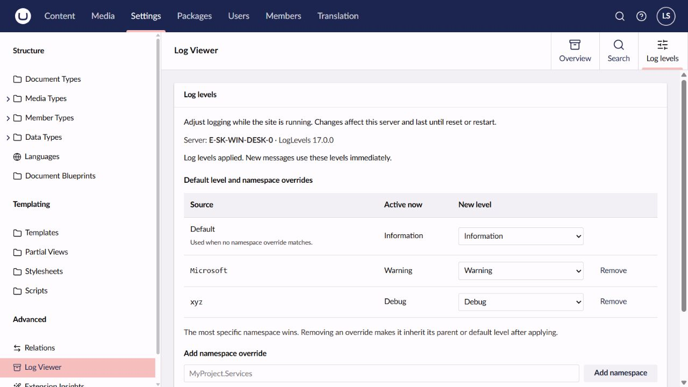

# Umbraco.Community.LogLevels

Change Serilog log levels and namespace overrides at runtime from **Settings > Log Viewer > Log levels**. The package targets Umbraco 18, with initial version **18.0.0**.

For setup and runtime behavior see the [NuGet guide](docs/nuget-readme.md). The package configures itself through an `IComposer`, with no changes to standard `Program.cs`. The [Marketplace guide](umbraco-marketplace-readme.md) introduces the package to site administrators.



## Languages

English, German, French, Dutch, Danish, Swedish, Italian and Spanish are included. The UI follows the user's backoffice language and falls back to English. Translation files and their `logLevels` keys are in `src/Umbraco.Community.LogLevels/Client/src/localization/`; register another Umbraco localization extension to add or customize translations.

## Repository layout

- `src/Umbraco.Community.LogLevels/Engine/`: immutable runtime rule snapshots and namespace filtering.
- `src/Umbraco.Community.LogLevels/Integration/`: automatic composer and Serilog configuration hook.
- `src/Umbraco.Community.LogLevels/Controllers/`: administrator-only Management API.
- `src/Umbraco.Community.LogLevels/Client/`: TypeScript/Lit source, generated API client and frontend build.
- `src/Umbraco.Community.LogLevels/wwwroot/`: built assets exposed at `/App_Plugins/LogLevels/` by the Razor class library.
- `tests/`: backend and logging integration tests.
- `tests/Umbraco.Community.LogLevels.TestSite/`: Umbraco 18 site with the Clean starter kit and a project reference to LogLevels.
- `docs/nuget-readme.md`: readme packed into NuGet.
- `umbraco-marketplace.json` and `umbraco-marketplace-readme.md`: Marketplace metadata and user guide.
- `.github/workflows/`: build/test and trusted-publishing workflows following Unlog's layout.

There is no additional settings schema or schema-registration target: LogLevels uses Serilog's existing settings rather than introducing another configuration section.

## Develop locally

Use the .NET 10 SDK and Node.js 24.13 or later with npm 11 or later.

```sh
cd src/Umbraco.Community.LogLevels/Client
npm ci
npm test
npm run build
cd ../../..
dotnet test Umbraco.Community.LogLevels.slnx --configuration Release
dotnet pack src/Umbraco.Community.LogLevels/Umbraco.Community.LogLevels.csproj --configuration Release --output artifacts
```

Build the frontend before packing. Generated frontend assets are committed with source so a normal .NET build does not need Node. The client targets `@umbraco-cms/backoffice` exactly `18.0.0`; the server requires Umbraco packages in `[18.0.0,19.0.0)`.

`Client/openapi.json` is the API contract for the generated TypeScript SDK. Run `npm run generate-client` after changing the contract, then build. Keep the JSON models synchronized with the C# controller types.

### Test site

```sh
dotnet run --project tests/Umbraco.Community.LogLevels.TestSite
```

The development profile installs Umbraco unattended using SQLite, so no database server or installation wizard is required. Open `http://localhost:56542/umbraco` and sign in with `admin@example.com` / `1234567890`. These public credentials are for local testing only. Clean installs its sample content during setup. Publish the Home page and save a dictionary item under Translation if the frontend is not yet visible, as described in the [Clean setup guide](https://www.nuget.org/packages/Clean/8.0.1).

Open **Settings > Log Viewer > Log levels** to try LogLevels. Rebuild the client with `npm run build` in `src/Umbraco.Community.LogLevels/Client` after frontend changes, then restart the site. Backend changes are included through the project reference.

The SQLite database, media, logs and generated Clean views/assets are ignored. The 18 branch uses `Umbraco18.sqlite.db`, keeping the 17 database separate when switching branches. Clean copies its assets and components on build and imports templates and sample content on first installation. Make permanent theme changes in a separate site. This site is for local development.

## Releases

`main` targets Umbraco 18. The Umbraco 17 version is maintained on `v17/main`. Package versions must follow the corresponding Umbraco major; dependency floors remain the major's `.0.0` release.

The publish workflow on `main` accepts `v18.x.y` tags; the workflow on `v17/main` accepts `v17.x.y` tags. Each workflow builds both parts, tests, validates the NuGet identity/dependency range/assets and publishes through NuGet trusted publishing. Before publishing, create a `release` environment and its `NUGET_USER` secret, then configure a matching nuget.org trusted-publishing policy for `publish.yml`. Nothing in the local build creates the repository or publishes the package.

## License and icon

Source is [MIT licensed](LICENSE). The purple/lime package icon uses the same equalizer geometry as Umbraco's `icon-equalizer`. The Lucide attribution and license are in [THIRD-PARTY-NOTICES.md](THIRD-PARTY-NOTICES.md).
